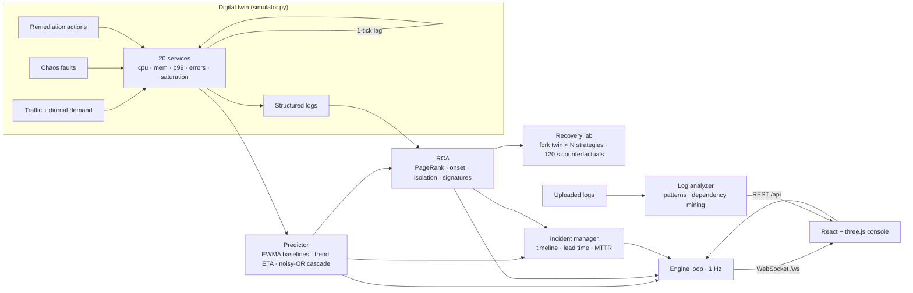

# Riptide — Cascading Failure Intelligence

> **Track 01 · Software & AI.** An AI system that predicts cascading software failures, identifies their root causes, and recommends the optimal recovery strategy *before* the entire system crashes.

Riptide watches a live, 20-service production platform (a digital twin of an e-commerce stack), forecasts which services will fail next and when, traces the failure back to its origin, and **simulates every candidate fix two minutes into the future** before recommending one. All of it is shown in a real-time 3D command center.

---

## What it does

| Capability | How |
|---|---|
| **Predict** which components fail next | Per-metric EWMA baselines (learned only while healthy) → anomaly z-scores; least-squares trend extrapolation to failure thresholds (OOM, pool exhaustion, error budget, latency ceiling) → per-service *time-to-failure* |
| **Trace** how the failure spreads | Noisy-OR propagation of failure probability over the weighted dependency DAG, with propagation delays → a predicted **failure wavefront** (who fails, in what order, how soon) |
| **Identify the root cause** | Personalised PageRank over the anomalous subgraph (MicroRCA-style, edges weighted by health correlation) + anomaly onset order + dependency isolation + blast-radius coverage, then signature classification (memory leak, bad deploy, pool exhaustion, cache failure, broker backlog, provider degradation, traffic overload) with explainable evidence |
| **Compare recovery strategies** | For each candidate (rollback, restart, scale-out, circuit breaker, failover, rate limit, provider switch, rebalance), fork the digital twin, apply it, simulate 120 s, and score availability, time-to-recover, peak blast radius, end health and operational risk against a *do-nothing* baseline |
| **Run the incident** | Incidents open automatically on prediction, record a full timeline, measure **prediction lead time** and **failures prevented**, and export a markdown post-mortem |
| **Analyse your own logs** | Upload any log file: Riptide parses levels/services, infers the dependency graph from upstream references, detects failure precursors and ranks the probable origin |
| **Autopilot (self-healing)** | One switch closes the loop: once a diagnosis is confident, Riptide simulates the options and executes the winner itself, with a cooldown so each action can take effect |
| **What-if blast radius** | Click any service → *Simulate outage*: a forked twin hard-fails it for 60 s and every casualty is ringed in magenta in 3D with its failure time |
| **Built-in benchmark** | Replays every failure class on independent twins (3 seeds each) and reports root-cause accuracy, warning lead time, availability with vs without Riptide, and false alarms |

### Measured results (Benchmark page, `GET /api/benchmark`)

| Metric | Result |
|---|---|
| Correct root cause | **100%** (21/21 replayed incidents) |
| Root cause named before any service failed | **100%** |
| Mean warning before the first failure | **≈39 s** (64–74 s for slow-burn leaks / pool exhaustion / broker stalls) |
| Mean time to correct diagnosis | **≈9.6 s** from fault onset |
| Availability over the next 2 min | **94%** with Riptide's fix vs **71%** doing nothing |
| False alarms | **0** in 15 min of healthy traffic |

These are measured on the built-in digital twin, not production traffic. The twin's physics and the scenarios were written by the same team, so the numbers show the pipeline working end to end, not real-world accuracy.

Riptide never sees the injected ground truth. Chaos scenarios only change the twin's physics; the AI works from metrics and logs alone.

---

## Quick start

### Option A: Docker (one container, production build)

```bash
docker compose up --build
# open http://localhost:8000
```

### Option B: local development

```bash
# backend (Python 3.10+)
cd backend
pip install -r requirements.txt
uvicorn app.main:app --reload --port 8000

# frontend (Node 18+), in another terminal
cd frontend
npm install
npm run dev
# open http://localhost:5173  (proxies /api and /ws to :8000)
```

For a single-process local production run, `npm run build` in `frontend/`, then start uvicorn: FastAPI serves `frontend/dist` automatically.

### Tests

```bash
cd backend && python -m pytest -q
```

The suite checks, for every scenario, that the platform raises no false alarms when healthy, that the correct root cause and failure class are found, that the recommended strategy beats doing nothing, that failures are predicted ahead of time, that early remediation counts as a prevented failure, and that applying the recommendation resolves the incident.

---

## Five-minute demo script

1. **Landing → Open Command Center.** The 3D topology shows 20 services in three tiers (edge, application, data). Cyan particles are live requests.
2. **Chaos lab → "Payment memory leak".** Within seconds the payment node grows a violet *risk ring*; *Forecast* shows `Heap memory rising 0.5%/s → limit in ~80s` and the predicted wavefront `payment → checkout → api-gateway`.
3. **Root cause tab.** *Memory leak in payment, 100% confidence*, with evidence: heap slope, the release that preceded it, GC-pause logs, healthy downstream dependencies.
4. **Recover → Recovery Lab.** Every candidate future is simulated. *Roll back Payment* wins (≈99.8% availability, zero services lost) against *Do nothing* (OOM crash, checkout outage). Rolling restart only buys time, because the leak recurs.
5. **Apply.** Back in the console, the rollback progress bar runs and the node turns green.
6. **Incidents.** The timeline shows detection → prediction → diagnosis → action → resolution, with *failures prevented* and a downloadable post-mortem.
7. Turn on **Autopilot**, inject **Cache node failure**, and keep your hands off: Riptide detects the cache-miss storm, names Redis, simulates and restarts it, and the incident closes itself.
8. Click **Postgres Primary → Simulate outage** to show the what-if blast radius in 3D.
9. Finish on **Benchmark**: 100% root-cause accuracy, ≈39 s warning, 94% vs 71% availability, 0 false alarms.
10. Optional: **/analyzer?sample=cache-stampede** diagnoses a log file on arrival.

---

## Architecture



```
Orca/
├─ backend/
│  ├─ app/
│  │  ├─ topology.py     service graph, criticality weights, DAG helpers
│  │  ├─ simulator.py    digital twin: load, queueing, faults, actions, retries, logs
│  │  ├─ predictor.py    baselines, anomaly, time-to-failure, cascade propagation
│  │  ├─ rca.py          root-cause ranking + hypothesis classification
│  │  ├─ recovery.py     strategy generation + counterfactual evaluation
│  │  ├─ incidents.py    incident lifecycle, lead time, post-mortem export
│  │  ├─ logparse.py     bring-your-own-logs analyzer
│  │  ├─ scenarios.py    curated chaos scenarios
│  │  ├─ engine.py       1 Hz loop, snapshots, WebSocket broadcast
│  │  └─ main.py         FastAPI REST + WS, static UI hosting
│  └─ tests/             behavioural tests for every scenario
├─ frontend/
│  └─ src/
│     ├─ components/three/   NetworkScene (live 3D topology), HeroScene
│     ├─ components/console/ KPIs, chaos lab, forecast/RCA/service panels, logs
│     ├─ pages/              Landing, Console, Recovery, Incidents, Analyzer
│     └─ lib/                API client, WebSocket feed, zustand store
├─ Dockerfile            multi-stage: Vite build → slim Python runtime
└─ docker-compose.yml
```

### API

| Method | Path | Purpose |
|---|---|---|
| `WS` | `/ws` | 1 Hz snapshots: services, KPIs, forecast, RCA, incident, new logs |
| `GET` | `/api/topology` | services and weighted dependency edges |
| `GET` | `/api/state` | current snapshot |
| `GET` | `/api/catalog` | scenarios, fault kinds, actions |
| `POST` | `/api/scenarios/{id}` | inject a chaos scenario |
| `POST` | `/api/faults` | inject a custom fault `{kind, target, rate}` |
| `POST` | `/api/control` | `pause` · `resume` · `reset` · `step` · `speed` |
| `GET` | `/api/services/{id}` | metric history, baselines, z-scores, forecast, logs |
| `GET` | `/api/logs` | filter by `service`, `level`, `q` |
| `POST` | `/api/recovery/evaluate` | simulate all candidate strategies |
| `POST` | `/api/recovery/apply` | execute a simulated strategy `{strategyId}` |
| `POST` | `/api/actions` | manual operator action `{kind, target}` |
| `POST` | `/api/autopilot` | toggle self-healing `{enabled}` |
| `POST` | `/api/whatif/{id}` | blast radius of a hypothetical outage |
| `GET` | `/api/benchmark` | measured accuracy / lead time / availability (`?refresh=true` to re-run) |
| `GET` | `/api/incidents` | incidents and stats (MTTR, lead time, prevented) |
| `GET` | `/api/incidents/{id}/report` | markdown post-mortem |
| `POST` | `/api/analyze/logs` | analyse uploaded log text `{text}` |
| `GET` | `/api/analyze/sample?scenario=` | generate a realistic sample log |

### Configuration

| Variable | Default | Meaning |
|---|---|---|
| `PORT` | `8000` | HTTP port (container) |
| `RIPTIDE_SEED` | `42` | deterministic simulation seed |
| `RIPTIDE_STATIC` | `frontend/dist` | built UI directory to serve |
| `CORS_ORIGINS` | `*` | comma-separated allowed origins |
| `VITE_API_BASE` | same origin | build-time API base for a separately hosted UI |

The digital twin is in-process state, so run **one worker** per instance (the Dockerfile does).
