<div align="center">


# Riptide

### See the outage *before* it cascades.

An AI system that **predicts cascading software failures**, **pinpoints their root cause** and **simulates every recovery strategy**, all before the system crashes.

[](https://riptide-production-d8c4.up.railway.app)
&nbsp;
[](#problem-statement)


**[🌐 Live app](https://riptide-production-d8c4.up.railway.app)** · **[🖥️ Command Center](https://riptide-production-d8c4.up.railway.app/console)** · **[🏆 Benchmark](https://riptide-production-d8c4.up.railway.app/benchmark)** · **[📄 Log Analyzer](https://riptide-production-d8c4.up.railway.app/analyzer?sample=cache-stampede)**

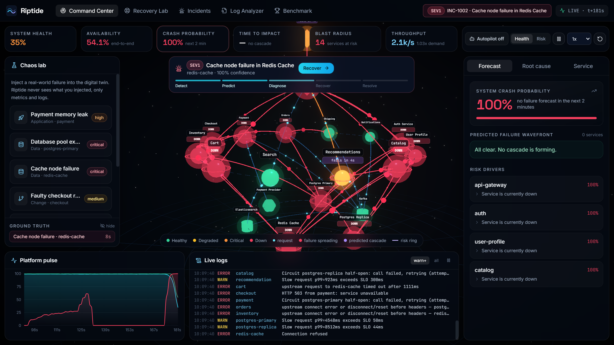

</div>

---

## Table of contents

- [Problem statement](#problem-statement)
- [The idea](#the-idea)
- [Screenshots](#screenshots)
- [Features](#features)
- [Measured results](#measured-results)
- [How it works](#how-it-works)
- [Architecture](#architecture)
- [Try it in 60 seconds](#try-it-in-60-seconds)
- [Run locally](#run-locally)
- [API reference](#api-reference)
- [Project structure](#project-structure)
- [Tech stack](#tech-stack)

---

## Problem statement

> **01 | Software & AI.** Build an AI system that predicts cascading software failures, identifies their root causes, and recommends the optimal recovery strategy before an entire system crashes. Analyse simulated server logs and service dependencies to predict which components may fail next, trace how failures could spread, and compare recovery strategies through a live dashboard.

## The idea

In production, services rarely fail alone. A memory leak in **Payment** becomes a **Checkout** outage, then an **API gateway** outage, and on-call engineers find out from the alerts after customers already have.

Riptide watches a live, 20-service e-commerce platform (a **digital twin**). It:
1. forecasts **which service fails next and when**,
2. traces **how the failure will spread**,
3. names the **root cause with evidence**,
4. **forks the system once per candidate fix and simulates two minutes into the future** of each, so it can recommend, or automatically apply, the fix that actually works.

> Riptide never sees what was injected. Chaos scenarios only change the twin's physics; the AI works from **metrics and logs alone**.

---

## Screenshots

<table>
<tr>
<td width="50%"><b>Landing</b><br/>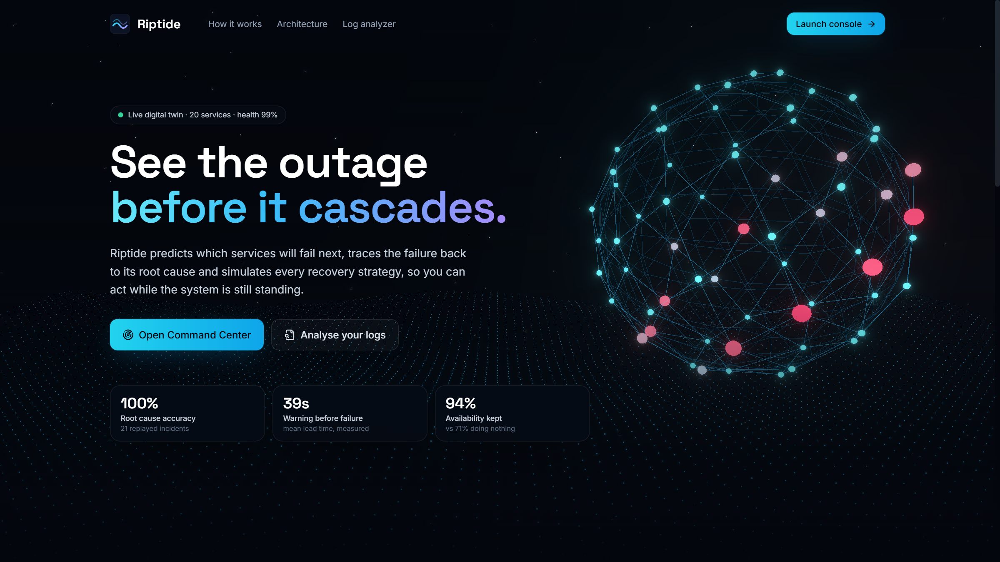</td>
<td width="50%"><b>Live 3D Command Center</b><br/>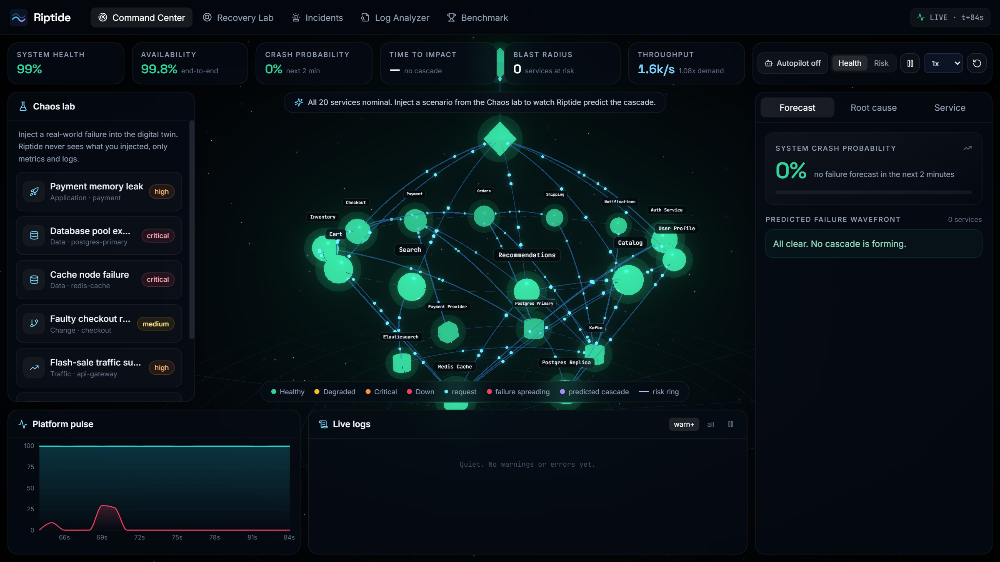</td>
</tr>
<tr>
<td><b>Prediction: heap leak forecast before any failure</b><br/>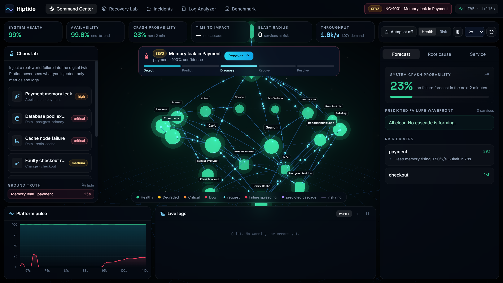</td>
<td><b>Root cause with explainable evidence</b><br/>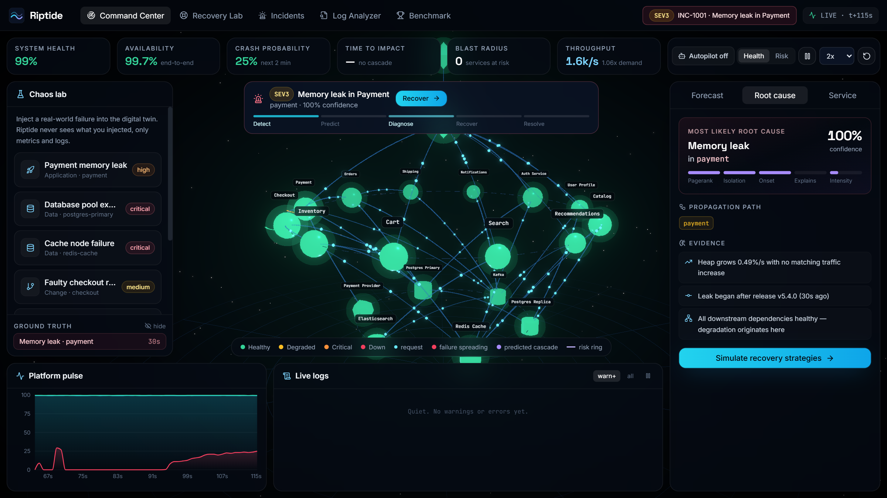</td>
</tr>
<tr>
<td><b>Recovery Lab: counterfactual futures per strategy</b><br/>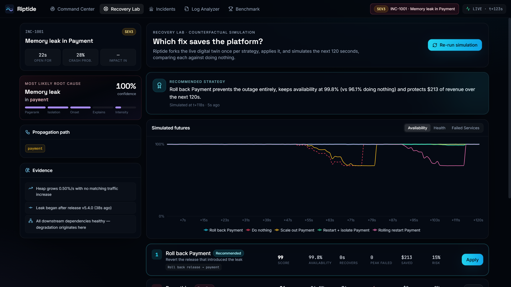</td>
<td><b>Cascade in progress: failure climbing the tiers</b><br/></td>
</tr>
<tr>
<td><b>Incidents: timeline, lead time, failures prevented</b><br/>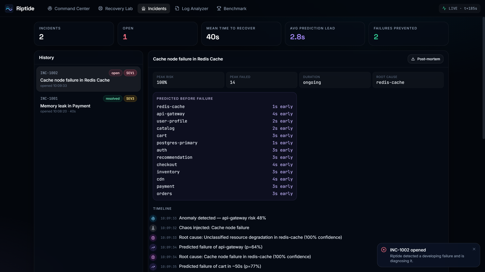</td>
<td><b>Benchmark: measured, not claimed</b><br/>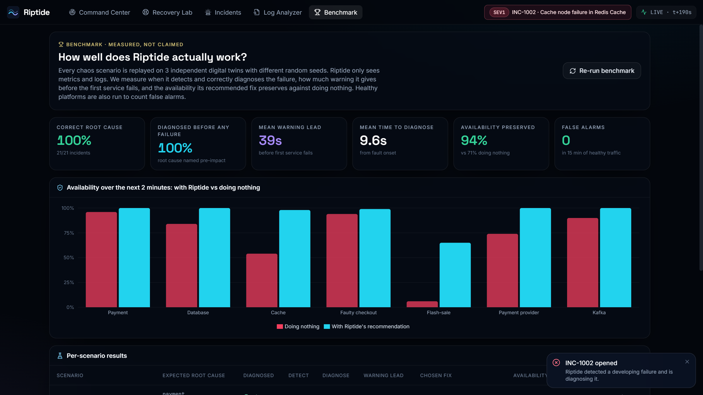</td>
</tr>
<tr>
<td colspan="2"><b>Log Analyzer: bring your own logs</b><br/>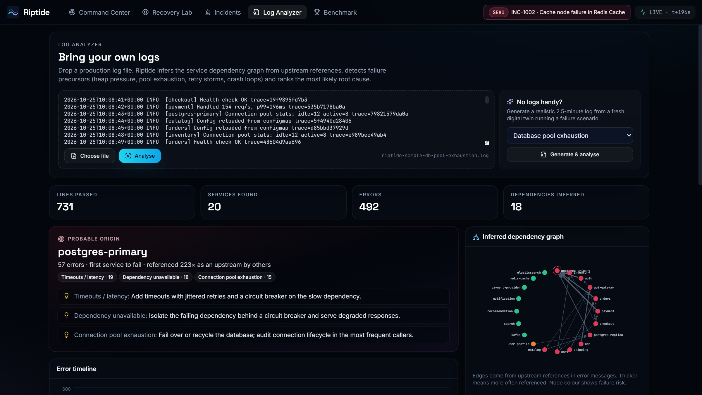</td>
</tr>
</table>

---

## Features

| | Feature | What it does |
|---|---|---|
| 🔮 | **Failure prediction** | Learns a healthy baseline per metric, scores anomalies, and extrapolates trends to failure thresholds (OOM, pool exhaustion, error budget, latency ceiling) to estimate **time to failure** |
| 🌊 | **Cascade forecasting** | Propagates failure probability across the weighted dependency graph to predict the **failure wavefront**: who fails, in what order, how soon |
| 🎯 | **Root-cause analysis** | Personalised PageRank over anomalous services plus onset order, dependency isolation and failure signatures. Names one of 7 failure classes with **explainable evidence** |
| 🧪 | **Recovery Lab** | Forks the digital twin once per strategy (rollback, restart, scale-out, circuit breaker, failover, rate limiting, provider switch, rebalance), simulates 120 s, and ranks by availability, time to recover, services lost and risk against *do nothing* |
| 🤖 | **Autopilot** | Self-healing: when the diagnosis is confident, Riptide simulates and **executes the best fix with no human click** |
| 💥 | **What-if blast radius** | Click any service and choose *Simulate outage*: every casualty is ringed in 3D with the second it fails |
| 🧭 | **Live 3D Command Center** | Three-tier topology with request particles, red failure pulses, violet predicted-cascade pulses and risk rings, streamed at 1 Hz over WebSocket |
| 🧾 | **Incident management** | Auto-opened incidents, live lifecycle (Detect → Predict → Diagnose → Recover → Resolve), prediction lead time, failures prevented, **downloadable post-mortem** |
| 📄 | **Log Analyzer** | Upload real logs: infers service dependencies, detects precursors (heap pressure, pool exhaustion, retry storms, crash loops) and names the probable origin |
| 🏆 | **Benchmark** | Replays every failure class on independent twins and reports accuracy, lead time, availability saved and false alarms |
| ⚡ | **Chaos Lab** | 7 realistic scenarios: memory leak, DB pool exhaustion, cache failure, bad deploy, flash-sale surge, provider brown-out, Kafka stall |

---

## Measured results

From the built-in benchmark ([live](https://riptide-production-d8c4.up.railway.app/benchmark), `GET /api/benchmark`): 7 failure classes × 3 independent seeds.

| Metric | Result |
|---|---|
| ✅ Correct root cause | **100%** (21 / 21 incidents) |
| ⏱️ Root cause named before any service failed | **100%** |
| 🔔 Mean warning before the first failure | **≈ 39 s** (64–74 s for slow-burn faults) |
| 🧠 Mean time to correct diagnosis | **≈ 9.6 s** from fault onset |
| 📈 Availability over the next 2 minutes | **94%** with Riptide vs **71%** doing nothing |
| 🚫 False alarms | **0** in 15 minutes of healthy traffic |

| Scenario | Chosen fix | Availability (nothing → Riptide) |
|---|---|---|
| Payment memory leak | Roll back Payment | 96% → 100% |
| Database pool exhaustion | Fail over Postgres | 84% → 100% |
| Cache node failure | Restart + bypass Redis | 54% → 98% |
| Faulty checkout release | Roll back Checkout | 94% → 99% |
| Flash-sale traffic surge | Adaptive rate limiting | 6% → 65% |
| Payment provider brown-out | Switch to backup provider | 74% → 100% |
| Kafka partition stall | Rebalance Kafka | 90% → 100% |

> These results are measured on the simulated digital twin, not production traffic. They demonstrate that the full pipeline works end to end; they are not a claim of real-world accuracy.

---

## How it works

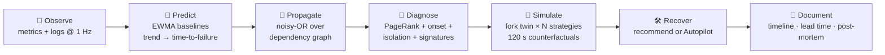

| Stage | Technique |
|---|---|
| **Baselines & anomalies** | Exponentially-weighted mean/variance per metric, updated **only while healthy** so incidents don't poison the baseline; z-score anomaly intensity |
| **Time to failure** | Least-squares slope over a sliding window with a significance test (slope > 2.5 × standard error), extrapolated to each metric's failure threshold |
| **Cascade risk** | Noisy-OR propagation in topological order: `P(i) = 1 − (1 − p_local) · Π(1 − w·P(dep))`, with criticality weights and propagation delays giving a predicted ETA per service |
| **Root cause** | Personalised PageRank on the anomalous subgraph (edges weighted by health correlation, MicroRCA-style), combined with dependency isolation, onset order, blast-radius coverage, and load-coupling edges (cache → database fall-through) |
| **Classification** | Signature rules over metric trends, change events (deploys), crash events and log patterns → 7 failure classes |
| **Recovery** | Strategies generated from the diagnosis, each evaluated on a deep-copied twin. Score = availability, time to recover, peak failures, end health and action risk |

---

## Architecture

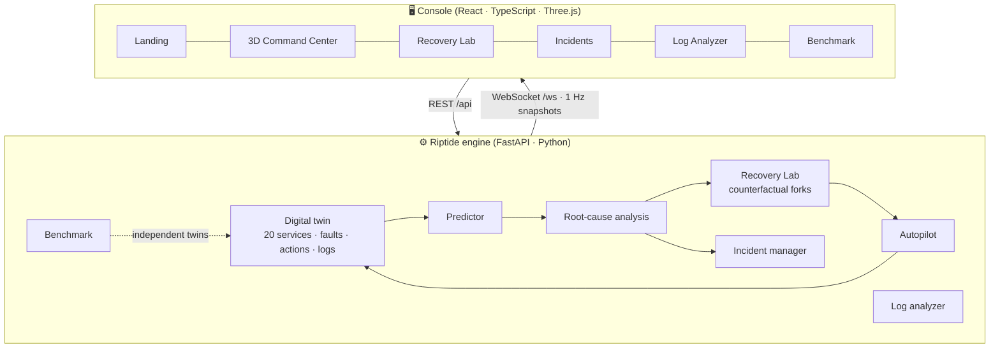

A single Docker image: Vite builds the console, and FastAPI serves the API, the WebSocket stream and the static UI. It is deployed on **Railway**.

---

## Try it in 60 seconds

1. Open the **[Command Center](https://riptide-production-d8c4.up.railway.app/console)** and press ⟳ **Reset** (top right).
2. In **Chaos lab**, click **Payment memory leak**. Watch the **Forecast** panel predict the heap running out and the cascade forming.
3. Open the **Root cause** tab: *Memory leak in Payment*, with its evidence.
4. Click **Recover**. The Recovery Lab simulates every fix, and **Roll back Payment** wins. Click **Apply**.
5. Turn on **Autopilot**, inject **Cache node failure**, and keep your hands off while Riptide heals the platform itself.
6. Click any 3D node and choose **Simulate outage** to see its blast radius.
7. Finish on **[Benchmark](https://riptide-production-d8c4.up.railway.app/benchmark)**.

> On a free host the first load can take a few seconds while the container wakes up.

---

## Run locally

**Docker (recommended)**
```bash
docker compose up --build
# → http://localhost:8000
```

**Development**
```bash
# backend
cd backend
pip install -r requirements.txt
uvicorn app.main:app --reload --port 8000

# frontend (new terminal)
cd frontend
npm install
npm run dev            # → http://localhost:5173 (proxies /api and /ws)
```

**Tests**
```bash
cd backend && python -m pytest -q     # 30 behavioural tests
```

The tests check, for every scenario:
- no false alarms when healthy;
- the correct root cause and failure class;
- the recommended fix beats doing nothing;
- failures are predicted ahead of time;
- Autopilot heals without a human;
- what-if runs never touch the live system.

| Variable | Default | Purpose |
|---|---|---|
| `PORT` | `8000` | HTTP port |
| `RIPTIDE_SEED` | `42` | Deterministic simulation seed |
| `RIPTIDE_STATIC` | `frontend/dist` | Built UI directory |
| `CORS_ORIGINS` | `*` | Allowed origins |

---

## API reference

| Method | Endpoint | Description |
|---|---|---|
| `WS` | `/ws` | Live snapshots: services, KPIs, forecast, RCA, incident, logs |
| `GET` | `/api/health` | Health check |
| `GET` | `/api/topology` | Services and weighted dependency edges |
| `GET` | `/api/state` | Current snapshot |
| `GET` | `/api/catalog` | Scenarios, fault kinds, actions |
| `POST` | `/api/scenarios/{id}` | Inject a chaos scenario |
| `POST` | `/api/faults` | Inject a custom fault `{kind, target, rate}` |
| `POST` | `/api/control` | `pause` · `resume` · `reset` · `step` · `speed` |
| `GET` | `/api/services/{id}` | Metric history, baselines, z-scores, forecast, logs |
| `GET` | `/api/logs` | Filter by `service`, `level`, `q` |
| `POST` | `/api/recovery/evaluate` | Simulate all candidate strategies |
| `POST` | `/api/recovery/apply` | Execute a strategy `{strategyId}` |
| `POST` | `/api/actions` | Manual action `{kind, target}` |
| `POST` | `/api/autopilot` | Toggle self-healing `{enabled}` |
| `POST` | `/api/whatif/{id}` | Blast radius of a hypothetical outage |
| `GET` | `/api/benchmark` | Measured accuracy and impact (`?refresh=true`) |
| `GET` | `/api/incidents` | Incidents and stats |
| `GET` | `/api/incidents/{id}/report` | Markdown post-mortem |
| `POST` | `/api/analyze/logs` | Analyse log text `{text}` |
| `GET` | `/api/analyze/sample?scenario=` | Generate a realistic sample log |

---

## Project structure

```
riptide/
├── backend/
│   ├── app/
│   │   ├── topology.py     # service graph + criticality weights
│   │   ├── simulator.py    # digital twin: load, queueing, faults, actions, retries, logs
│   │   ├── predictor.py    # baselines, anomalies, time-to-failure, cascade propagation
│   │   ├── rca.py          # root-cause ranking + failure classification
│   │   ├── recovery.py     # strategy generation, counterfactual evaluation, what-if
│   │   ├── incidents.py    # incident lifecycle, lead time, post-mortems
│   │   ├── logparse.py     # bring-your-own-logs analyzer
│   │   ├── benchmark.py    # offline evaluation on independent twins
│   │   ├── scenarios.py    # chaos scenarios with ground-truth labels
│   │   ├── engine.py       # 1 Hz loop, autopilot, snapshots, WebSocket broadcast
│   │   └── main.py         # FastAPI REST + WebSocket + static UI
│   └── tests/              # 30 behavioural tests
├── frontend/src/
│   ├── components/three/   # 3D topology + hero scenes
│   ├── components/console/ # KPIs, chaos lab, forecast / RCA / service panels, logs
│   ├── pages/              # Landing, Console, Recovery, Incidents, Analyzer, Benchmark
│   └── lib/                # API client, live feed, store
├── docs/screenshots/
├── Dockerfile · docker-compose.yml · render.yaml
└── README.md
```

---

## Tech stack

**Backend:** Python 3.12 · FastAPI · Uvicorn · WebSockets · Pydantic · pytest
**Frontend:** React 18 · TypeScript · Vite · Three.js · React Three Fiber · Drei · Postprocessing (bloom) · Tailwind CSS · Framer Motion · Recharts · Zustand · React Router · Lucide
**Deployment:** Docker (multi-stage) · Railway
**AI tools:** Claude Code (Anthropic) was used as an AI coding assistant during development.

---

<div align="center">

**Built by [Daanial Mirza](https://github.com/daanialmirza5) for Orca Coder.**

*Riptide: predict · diagnose · recover.*

</div>
